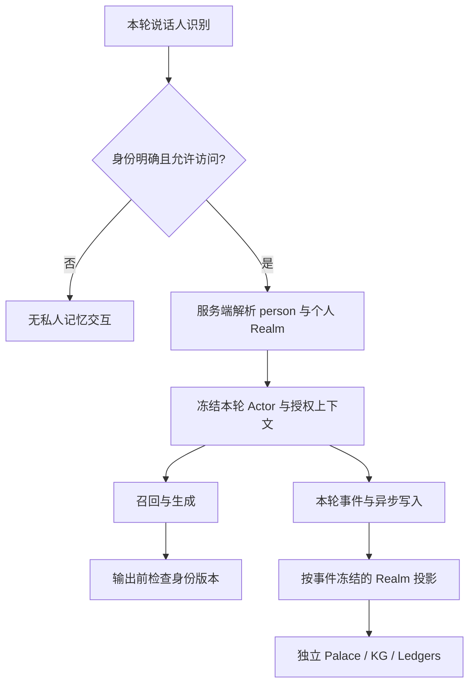

# 多 Person 身份与记忆隔离方案

日期：2026-10-28。最新产品规则与实现见第 26 节。已完成现有 Mac 联合发布、健康检查和手机覆盖安装，见 [部署记录](MAC_PERSON_MEMORY_DEPLOYMENT_20261028.md)；第 26 节末的未发布说明保留为发布前记录。第 13–25 节保留历史背景，其中“换人必须新建 conversation”“controlled_trial 不得启用记忆”等旧结论已被第 26 节取代。

当前产品规则（2026-10-28 更新）：新建 Person 默认开启独立个人记忆，列表直接提供状态和开关；已有暂停状态不自动恢复。见 [默认开启与验收](PERSON_MEMORY_ACCEPTANCE.md)。Mobile 与 Device 不主动选 Person；另一个 session 负责声纹识别及 SpeakerIdentityObservation。本任务负责记忆授权、隔离与生命周期。观察结果不是授权凭据；未知、不确定或不可用时不得访问旧默认 Realm。旧默认数据保留，多模态暂不接入。

## 1. 决策摘要

第一阶段复用现有 Realm 物理隔离：每个需要私人记忆的人，由可信身份服务解析到自己的个人 Realm。Memory 继续保持 `memory_space_id == memory_realm_id`，不另建 person 向量库路由。

多 Person 识别回答“谁在说话”；授权回答“这次交互可以读写谁的记忆”。二者必须分开。设备所有者、登录账户、当前说话人和被谈论的人也不是同一个概念。

第一阶段支持一个交互时刻一个已授权说话人的私人记忆。多人同时发言、家庭共享记忆和跨 Realm 联合召回留到后续明确授权模型后实施。身份不确定时不降级到设备主人的私人 Realm。

多模态暂不接入，待 MemPalace 稳定后重新评估。MemPalace 升级作为独立工作推进：可以采用新版更好的机制并删除重复实现，但需先验证本方案的隔离与生命周期契约。多 Person 不依赖上游新增多模态能力。

## 2. 已有能力与缺口

| 项目 | 已确认现状 | 边界 |
|---|---|---|
| Actor 契约 | 既有 owner/companion/council/realm/device/session，加成对的 `person_id`/`identity_epoch`；space 必须等于 realm | 个人上下文必须有 session；修改 person 字段本身不构成授权，也不自动换库 |
| 空间路由 | 每个空间独立 Palace、KG、canonical facts、commitments 等 ledgers 和锁 | 独立文件不等于操作系统级租户沙箱；可信服务仍可能管理多个空间 |
| 路径保护 | 拒绝不同空间占用同一个 Palace 目录；空间和目录均有进程锁 | `allowed_spaces` 是部署范围，不能当作最终用户授权 |
| Audience | owner、companion、council 三种可见性轴 | Companion 是 AI 伙伴，不是人类用户；owner 是 Realm 内共享层 |
| 查询 | 适配器支持 audience/device 条件下推；KG 有自己的范围过滤 | metadata 中随意添加 person 不会自动成为过滤条件 |
| 普通交互 | 缺少 companion/council 身份时策略拒绝，不默认写入 owner shared | 不能把模型自行生成的身份字符串视为权威身份 |
| Owner HTTP | 服务凭据保护，路由使用已选定空间 | 服务凭据认证上游服务，不认证人类用户 |
| Council | 数据层有 audience 表达 | Agent 面拒绝裸 council_id，权威参与者适配未完成 |

依据：

- [Actor 契约](../contracts/eidolon_memory_contracts/payloads.py)
- [空间与 NATS 命名](../contracts/eidolon_memory_contracts/subjects.py)
- [Audience 契约](../contracts/eidolon_memory_contracts/audience.py)
- [LocalPalaceRouter](../eidolon/memory/adapters/local_palace_router.py)
- [交互范围策略](../eidolon/memory/application/scope_policy.py)
- [检索过滤](../eidolon/memory/adapters/mempalace_fast_search.py)
- [HTTP 信任边界](../eidolon/memory/entrypoints/memory_api.py)
- [MCP Agent 边界](../eidolon/memory/entrypoints/mcp_server.py)

Actor 模型当前没有设置 `extra="forbid"`；因此不能依靠“把 person_id 塞进旧 payload”实现迁移，必须升级共享契约并验证接收端确实消费新字段。

## 3. 身份模型和职责

| 概念 | 定义与责任 |
|---|---|
| account / owner | 账户或管理关系，维持现有 owner_id 语义；不直接改为当前说话人 |
| person | 身份服务管理的稳定自然人标识；不使用姓名、声纹向量或临时聚类编号作为主键 |
| speaker observation | 本轮识别结果，可未知、冲突或低置信；由上游判定是否足以绑定 person |
| personal Realm | 私人记忆的存储与授权范围；由服务端注册关系确定 |
| Companion | AI 伙伴身份，同一个人可使用多个伙伴 |
| subject entity | 记忆描述的对象；提到李四不赋予李四访问该记录的权限 |
| audience | 当前 Realm 内的可见性范围；不能承担跨自然人的认证 |

身份服务负责 person 注册、识别结果解析及生命周期；授权/会话服务负责设备使用资格、person→Realm 映射和本轮读写许可；Memory 负责执行已验证的范围、保持数据完整性、拒绝不一致上下文。具体服务名称由多 Person session 对齐，本文不假定其已实现这些职责。

识别置信度只能作为授权策略输入之一，不应把声纹命中直接等同于完整账户认证。首次绑定、身份冲突和访客是否可访问个人记忆，必须由上游已有认证机制或明确确认流程决定。

## 4. 第一阶段数据流

张三和李四使用同一设备、同一 Companion 时，应解析到不同 Realm。不得按设备 ID 选择唯一私人库。新请求携带的 realm 只能来自可信会话服务，不能由终端、对话文本或 LLM 工具参数任意选择。

Memory 的内部 MCP/NATS 入口应继续处于可信服务边界。仅校验字符串格式或 space=realm 不能证明用户获准访问；若未来直接暴露给不可信客户端，必须增加独立的可验证授权绑定，不能复用管理端全局服务凭据作为用户凭据。

## 5. 跨服务契约提案

以下字段已用于当前共享契约与运行时接线；真实跨进程消费与多 Person 调用方仍需联合验收。

| 字段 | 用途 |
|---|---|
| `person_id` | 本轮已解析的自然人，不替换 owner_id |
| `identity_epoch` | 授权绑定版本；当前 session 内不可变，不能仅递增此字段实现换人或撤权 |
| 既有 `memory_realm_id` / `memory_space_id` | 保持相等，由可信映射生成 |
| 既有 `session_id` / `device_id` / `companion_id` | 继续用于交互、来源与范围，不承担人类身份替代作用 |
| 授权绑定 | 可信内部上下文或可验证凭据，绑定 person、Realm、会话、允许操作及有效期；具体载体取决于现有传输认证 |

识别原始分数、声纹及音频不必进入每条记忆。未知身份不使用一个所有访客共享的“私人 Realm”。第一阶段未知身份不提交私人长期记忆写入，仍可进行不依赖私人记忆的对话。

读写两端必须使用同一个冻结上下文。命令、事件、重试、DLQ 与恢复流程保留原始 person/Realm/epoch，不从执行时的“当前用户”重新解析。校验 NATS subject、payload context、目标 runtime 与命令内部 space 一致；不一致时拒绝并记录可诊断原因。

第一阶段优先使用已有每 Realm 服务路由和 subject 约定，不新增另一套 person topic 或数据库目录命名。

## 6. 身份切换与并发

1. 识别到可能换人时，暂停新的私人记忆调用，完成身份与授权解析。
2. 第一阶段必须关闭旧 session，等待设备清理确认，再以新 session/conversation 建立新人物的不可变授权绑定；不在同一会话替换上下文。
3. 清理旧用户的对话上下文、已注入记忆、生成任务和待播放语音；只切换数据库不足以防止旧记忆从模型上下文泄露。
4. 召回返回时检查完整绑定，旧 session 的输出不能交给新用户；设备清理未确认时禁止开启下一会话。epoch 比较本身不保证音频清理。
5. 旧用户已接受的写入仍只属于旧 Realm；切换不把写入改投新 Realm。若发生授权撤销，应按撤销策略取消未执行操作，不能将“切换”和“撤销”混为一谈。
6. 迟到事件、离线重放和重试必须携带原范围；身份字段缺失或冲突时不能回退到设备主人。

查询结果缓存必须包含 Realm 及所有影响可见性的范围，或在授权改变时失效。纯文本 embedding 缓存可以评估跨空间复用，但不得混入召回结果、个人 metadata 或可见性状态。审计现有缓存键后再决定具体修改。

## 7. 写入、修正、遗忘和人物归属

在个人 Realm 内，“我”的事实归属由冻结的 person 上下文确定，不能由 LLM 猜测当前主人。关于他人的事实仍保留在来源交互获准写入的 Realm，不自动复制到被谈论人的库。

新字段须沿现有 assertion/evidence/projection 生命周期传递。不能增加一个不受 supersede/forget 管理的原话或人物索引旁路。删除与导出先定位已授权 Realm，再执行既有范围规则。

识别纠错不等于修改 person_id：如果历史事件归错人，应先停止错误投影可见性，审计受影响事件，再通过显式、可重放流程撤销或重投影。跨 Realm 转移涉及双方权限和来源归属，第一阶段不自动执行。

## 8. 既有数据与兼容上线

- 不因新增 person 自动重命名旧 Realm 或 `mempalaces-v3.9` 目录；目录后缀是既有数据 epoch。
- 当前迁移保留旧默认 Realm 的数据和 ID，不自动绑定到新 Person；未来若要转移归属，需独立的显式授权与迁移验收。
- 曾由多人混用的 Realm 标记为待确认，不靠文本中的名字或模型推断批量分家；无法确认归属的记录不自动授予新 person。
- SDK/Agent/Channel 协调升级到单一 v6，旧 v5 凭据必须重新签发并重连，不保留双协议运行。Memory 共享契约接收方须先就绪，验证字段确实被消费；Data 与 Provider 数据迁移须先演练。
- 回滚时停用多 Person 入口，不能让旧版本忽略 person 后继续共享读取。数据目录与映射备份一起恢复，避免版本回退造成身份含义改变。

## 9. 家庭共享与多人会话：第二阶段

后续可评估独立 Shared Realm，以显式成员资格共享指定内容。个人事实默认不复制进去；共享必须有明确操作、来源和撤销语义。个人库与共享库联合召回，需要分别授权、保留结果来源并统一预算。

不建议第一阶段把多个自然人都放入现有 owner audience，再通过额外 metadata 临时区分。若未来选择同 Realm 内 person ACL，必须同步扩展 canonical/KG/向量/列表/导出/遗忘/缓存全部路径，并重新证明过滤下推与授权正确性。

Council 已有存储表达不意味着多人参与者授权已经完成。多人会话需要权威参与者集合、参与者变更、谁可查看历史和如何撤回等规则，完成前保持当前 Agent 面限制。

## 10. 实施分工与顺序

| 阶段 | 工作 | 完成条件 |
|---|---|---|
| A：跨 session 对齐 | 明确 person、owner、Realm 生命周期；确认识别与授权服务责任 | 有一致字段定义、身份状态与失败行为，不以临时 speaker 标签当稳定 person |
| B：共享契约 | 增加 person/epoch 及可信授权绑定，覆盖事件与命令 | 新旧接收方行为可验证，身份缺失不悄悄进入私人库 |
| C：会话接线 | person→Realm 路由、上下文冻结、切换与迟到结果丢弃 | 同设备换人时读写和语音输出均隔离 |
| D：Memory 接线 | 核对路由一致性、投影来源、范围过滤、缓存、重放和管理操作 | 以下隔离矩阵通过，且不新增平行事实存储 |
| E：数据与发布 | 绑定旧 Realm、标记混用数据、备份及回滚演练 | 可解释每个 Realm 归属，多 Person 开关可安全关闭 |
| F：后续共享 | 家庭 Shared Realm / Council 权限设计 | 独立评审与验收，不混入第一阶段默认开放 |

MemPalace 升级独立进行兼容验证，避免同时改变身份路由、embedding 模型和存储布局，使故障难以归因。

## 11. 验收矩阵

| 场景 | 必须满足 |
|---|---|
| 同设备、同 Companion，A/B 交替 | B 读不到 A 的私人向量、词法结果、KG、承诺或来源信息 |
| 相同事实文本分别写 A/B | ID/去重/缓存不跨 Realm 合并；删除 A 不影响 B |
| 不同设备访问同一已授权 person | 按同一个人解析 Realm，同时遵守既有设备可见性规则 |
| A 召回中途切换 B | A 的迟到结果、模型上下文和待播放语音不交给 B |
| A 写入在切换后执行 | 保留 A 的事件归属，不投到 B；撤权情形按策略拒绝 |
| 未识别、低置信、身份冲突、访客 | 无主人私人读取、无自动归入主人长期记忆 |
| 伪造 person/Realm，subject 与 payload 不一致 | 拒绝；不打开或写入攻击者选择的空间 |
| 列表、导出、修正、遗忘、图谱历史分页 | 每个入口执行同一授权边界，分页 cursor 不能跨范围复用 |
| 重启、DLQ、离线重放 | 原身份和 Realm 保留，重复事件不重复投影 |
| 旧客户端与回滚 | 多 Person 场景不能忽略新字段后继续访问私人数据 |
| 误识别纠错 | 有审计和撤销/重投影流程，不静默搬库 |

复用现有 `test_mcp_multi_space.py`、`test_audience_isolation.py`、`test_companion_audience_isolation.py`、`test_scope_policy.py`、`e2e/test_scope_visibility.py` 与 `e2e/test_privacy_lifecycle.py`，增加真实 A/B 切换及跨服务契约测试。已有测试文件存在不代表本方案已验收。

上线观测至少区分：身份未解析、授权拒绝、上下文不一致、过期 epoch 结果丢弃、Realm 打开失败、投影失败。日志默认不包含原始私人记忆或声纹；不得把高基数 person ID 直接作为指标标签。

## 12. 与另一个 session 的对接清单

需要对齐：稳定 person_id 的来源；owner 与 person 的关系；个人 Realm 的创建/绑定权威；身份确认及撤销策略；session 的 epoch 和切换通知；异步事件冻结位置；单设备多人轮流与多人同时发言的产品边界。

本方案推荐先完成“可信 person→个人 Realm”的闭环。其落地价值是复用已经存在的物理隔离，而不是把“已识别人”误当成“已隔离记忆”。

## 13. 实施记录：Memory 接收端基础（2026-10-27）

状态：首批接收端代码已实现，未提交、未部署，整体验收未完成。

已读取跨仓 `docs/跨系统/OS用户与声纹辅助识别重构.md`：Data 已承担 Person 管理，Person 属于 Owner，识别不授予访问凭据；该项目明确未实施自动记忆归属。因此本仓没有创建 Person 镜像表，也没有根据声音命中自动建 Realm。

本轮完成：

- Actor 新增可选 person_id/identity_epoch，要求成对提供，epoch 为非负严格整数，绑定 person 时 session_id 必填。旧单用户 Actor 仍可解析；这只是可信调用方提供的来源上下文，不是授权凭据。
- MCP recall 与 LiveKit recall 响应增加 identity_binding。LiveKit 调用开始时复制上下文，迟到响应仍标记原请求身份，供消费方比较并丢弃；消费方丢弃动作尚未接入。
- Fragment 从可信 turn context 覆盖 person/epoch，存储 metadata 保留来源；模型输出不能自行决定该来源。该字段不是新的 ACL，也不替代 Realm。
- 保持旧事件 extraction hash 与旧 fragment intent ID 的计算兼容，避免新增空字段使历史重试冲突。新身份上下文参与事件 hash。

验证：首次相关契约/范围回归 114 passed；非 e2e Memory 回归 1261 passed、4 skipped、4 项因沙箱本机端口限制失败。允许绑定本地临时端口后，相关两个测试文件 11 passed。随后修复历史 hash 兼容并完成契约、person、intent、decision 回归 103 passed。各组有重叠，不相加。修改范围 Ruff 与 git diff --check 通过。没有进行真实家庭数据、NATS 端到端或跨仓部署验证。

剩余工作（不能以本轮通过宣称完成）：

1. Data 权威的 person→个人 Realm 绑定、管理操作与旧数据归属确认。
2. Agent 权限校验后的 Actor 构造，事件/命令及输出全链路 epoch 传递；Channel 切换时清理上下文、取消/丢弃旧生成和音频。
3. 启用多 Person 场景的入口必须拒绝缺失绑定；目前兼容入口仍接受旧 Actor，不能直接面向多 Person 开放。
4. canonical/KG/commitments 的人物来源与纠错审计应继续核查；本轮只接入 fragment 来源，不声称全生命周期已经覆盖。
5. 接收方能力/契约版本协商、跨仓依赖固定、真实 A/B Realm 写入召回与遗忘验收、迁移及发布。

多模态和 MemPalace 依赖版本均未改变。

## 14. 跨仓约束核实与目录实施（2026-10-27）

用户已确认采用“Owner 默认 Realm + 每 Person 独立私人 Realm”。此前方案只核实了 Memory 多空间能力，未核实 Data 的 `uq_memory_realms_owner_active`，这是方案缺口：原 Data 模型不允许同一家庭 Owner 有多个 active Realm。

本轮修改 Data 的既有目录模型和迁移 `0011_person_memory_realms`：

（历史编号：尚未发布的该迁移已在第 21 节整合时顺延为 `0012_person_memory_realms`。）

- `memory_realms.person_id` 为空代表 Owner 默认库；默认库保留原 ID 与数据。
- 默认库 active 唯一索引缩小到 person_id 为空；个人库对 `(owner_id, person_id)` 唯一，包含 inactive 状态，防止重复创建后丢失旧库关联。
- 两处默认 Realm 选择器显式排除个人库，Companion 默认路由不变。Owner 归档仍停用所有所属 Realm。
- 在既有 Persons 服务与服务鉴权 API 下增加显式 GET/PUT `/{person_id}/memory-realm`；GET 不创建，PUT 幂等创建目录指针，不直接创建 Memory 存储。
- Person 停用/删除会停用个人 Realm，但保留 person_id。该列有意不使用 `ON DELETE SET NULL`，否则私人库会被错误重分类为 Owner 默认库。保留记忆的 person_id 不允许通过普通创建复用；恢复需要独立显式操作，本轮未开放恢复接口。
- 有个人库的数据库拒绝降级，避免旧版本把私人数据作为默认库处理。

验证：Data 的 Person、默认工作区、API 鉴权、跨 Owner、数据库迁移及权限回归 38 passed。包括旧库默认记录保留、两个人库并存、重复默认/个人库拒绝、危险降级拒绝。均使用临时数据库，无生产迁移。

Memory 同时修正首批入口分散组装问题：身份快照由 `MemoryService.recall_fused` 产生，标准 RecallResult 与 MCP 复用，成功及降级路径均携带；不再由 MCP 在调用结束后从可能变化的上下文拼装。相关 106 项测试通过。

尚未完成 Agent/Channel 的个人模式选择与身份切换、旧结果取消、真实端到端验收；目录 API 的服务鉴权不是终端用户访问个人记忆的完整授权。当前只新增目录能力，未将声纹识别接入自动读写，不能宣称个人记忆产品已上线。Data 与 Memory 改动均未部署或提交。

## 15. 默认库泄露边界与跨仓读取契约（2026-10-27）

本轮发现旧 Data runtime-snapshot 只检查 Realm 的 owner/status，扩展后无法区分同 Owner 下个人库。现已在 Data snapshot 和 Agent 本地 authority 中拒绝个人 Realm 作为 Companion 默认库；新增错误默认指针测试，防止目录扩展后误公开私人数据。

复用 SDK `SystemDataRuntimeClient` 增加 `get_person_memory_realm`，统一类型为 `PersonalMemoryRealmSnapshot`。客户端核对 owner/person/active；404、inactive 或范围不一致都失败，不创建、不回退默认 Realm。Data API 使用同一 DTO。该查询仍只是服务目录查询，不是终端用户授权。

Agent 现有 MemoryPort 开始校验已返回的 identity_binding：不匹配时丢弃正文和命中，返回 identity_mismatch。旧无标记响应仅为现有无个人身份调用保持兼容；未来个人模式必须要求响应标记，不能延用这一兼容分支。

验证：Data 全部 integration 123 passed；SDK 新增个人 Realm 客户端边界测试 4 passed；Agent MemoryPort 与 runtime authority 回归 20 passed。未使用生产数据。

进一步确认的断路：Agent 的 RuntimeIdentity/RuntimeSessionAuthorizer 目前只有 Owner、Companion、Device、Session，Channel 签发的是 v5 runtime JWT，没有个人授权绑定。下一步必须沿签发者、验证者、会话 scope、TurnContext、history fanout、recall/commitments 和输出取消贯通，不能从任意 request metadata 直接切库。个人模式需采用可识别的新凭据版本，让旧接收方拒绝而不是忽略 person。旧 Session 的记录、生成和播放需在身份切换时隔离；SDK 查询方法不能被描述为这个闭环已完成。

本轮未修改运行时 JWT 或启用个人模式，未提交、未部署。

## 16. 核心会话接线评审（2026-10-27）

已把下一阶段收敛为显式个人会话，不做自动声纹授权或同会话热切换。具体协议、接线顺序及测试矩阵见 [个人运行时绑定评审](PERSON_RUNTIME_BINDING_REVIEW.md)。额外确认历史读取按 conversation_id 路由，必须在加载历史前拒绝跨人物复用，不能只替换 Realm。

共享 JWT v6 修改被自动审批拒绝，尚未执行；现有 tokens.py 与 HEAD 一致。待批准后按接收方先行的顺序推进，不以默认 Realm 回退绕过缺失授权。

## 17. v6 凭据与 Agent 内部读写接线（2026-10-27）

用户在评审与安全审批说明后回复“继续推进”，本轮据此实施 v6 个人凭据。

- SDK 签发有 person_id/identity_epoch 的 v6；无绑定保持 v5。验证拒绝 v5 夹带个人字段、v6 缺失绑定、未知版本和非法 epoch；现有会话撤销规则沿用。凭据测试 36 passed。
- Agent RuntimeSessionAuthorizer 接收个人绑定，复用 Data authority 查询个人 Realm，生成新的不可变 runtime facts，不修改 Companion 默认 facts，失败不回退。
- Actor 绑定沿 AuthorizedRuntimeSession → TurnContext → MemoryPort/承诺查询 → HistoryFanout/outbox payload 传递；普通旧调用仍兼容。个人召回和承诺结果缺失或不匹配 identity_binding 时丢弃。
- Memory 的 active_commitments MCP 返回相同身份标记。
- Agent gRPC 对个人凭据仍明确 FAILED_PRECONDITION，避免接收方升级后忽略个人字段而继续默认范围。解除此限制前必须完成历史加载隔离、Channel 显式签发和新会话切换。

验证：Agent 授权/历史/记忆/交互选定回归 43 passed；上下文 compiler/MemoryPort/gRPC 回归 74 passed；Memory contracts/person 回归 85 passed。测试组有重叠。Agent 静态检查仅发现 domain/agent/turn.py 原有 import 排序问题，本轮未修改 imports。未部署、未提交。

仍未完成：conversation 历史加载前的持久身份绑定校验、Channel 的可信显式选择与新会话签发、个人字段的完整持久化恢复审计、真实 A/B 端到端测试。个人产品入口仍未开放，不能视为已上线。

## 18. 删除 v5 兼容与历史入口隔离（2026-10-27）

依据用户对兼容复杂度的质疑，协议收敛为单一 v6：默认会话省略个人字段；个人会话提供 person_id/identity_epoch；显式 null、半绑定、v5 和未知版本拒绝。Channel 复用 SDK 签发，无独立旧协议分支。保留已有凭据撤销检查，不新增撤销设施；它不等于对进行中语音流的即时停止。第 17 节的双版本方案已被本节替代。

历史隔离在 Agent TurnEngine 最前端建立持久检查，避免在 compiler、缓存、摘要各处重复实现身份判断：

- 复用现有 ConversationRow 与唯一 conversation_id，原子认领并保存 Owner/Companion/Realm/person/epoch/session/device。并发不同身份只能一个成功。
- Owner/Companion/Realm 或 person 不一致拒绝；个人会话 epoch/session/device 变化必须新建 conversation。默认历史不能自动变成个人历史。旧记录缺失 Realm 归属也不猜测迁移。
- 拒绝发生在处理及清理逻辑之外，不读取历史，不调用 LLM，也不往错误 conversation 追加失败 turn。个人模式缺 guard 直接失败。
- 持久写入复用同一归属校验，保存 person/epoch；已有 turn_id 不能被另一 conversation 使用。拒绝事务不残留新 conversation 或改写原消息。
- 推测性请求也先认领会话；取消后可能留下空的绑定会话，这是有意保留的隔离边界，不允许重新认领给另一个人物。

发布要求：协调升级 SDK/Agent/Channel，旧 v5 重新签发并建立连接，不做静默降级。未运行生产迁移、未部署、未提交。

仍待完成：Channel 可信显式个人选择与新会话创建；运行中撤销/旧流停止及迟到音频处理；异步恢复链路完整审计；真实 A/B 端到端验收。个人 gRPC 入口保持明确拒绝，不能将本轮历史隔离测试描述为完整个人产品验收。

本轮验证：SDK runtime token 37 passed；Channel resolver 13 passed；Agent 持久化/会话隔离/TurnEngine/交互回归 66 passed；gRPC 与 RuntimeSessionAuthorizer 26 passed。git diff --check 通过。Agent 修改文件 Ruff 检查剩余 agent_runtime.py 原有 7 处 UP017（timezone.utc 风格）告警，HEAD 同样存在这 7 处，本轮未扩散修改。以上均为本地测试，不构成生产或真实语音切换验收。

## 19. Channel 可信选择与个人流候选实现（2026-10-27）

本节是第 18 节之后的当前状态。个人 gRPC 入口仍保持发布阻断，未部署；不能把下列接线理解为已经可以在真实家庭设备上启用。

### 已完成

1. Channel 的严格 `SessionRequest` 在已认证 Provider open 请求上接收 `personal_memory: {person_id, identity_epoch}`。复用同一冻结 DTO 校验 dispatch；不接受 Realm ID、空/null、半绑定、bool/string epoch 或未知字段。设备自己的 ServingRequest 不具备该授权字段，适配器也拒绝 device_requested 选择个人。团队、远端展示和家庭控制应用不进入本阶段个人路径。
2. 选择沿 Provider service → LiveKit dispatch → server → factory → ChannelRuntimeServices → SDK signer 传递。只读 dispatch，不从 participant metadata、语音识别或模型结果取 person。RuntimeServices 先解析可信 Owner/Companion，再复用 SDK/Data 查询 active 个人 Realm。失败不缓存默认上下文；不修改 Companion 默认 facts。
3. 个人模式使用 dispatch session ID 构造独立 Agent conversation ID，绕过原有按稳定设备身份续接历史的路径。普通默认会话行为保留。同 dispatch 改 person/epoch 或改回默认模式拒绝，新 conversation 不能隐式接管仍存在的私人会话。
4. SDK 签发仍是单一 v6。个人 token resolver 在已关闭 session 上拒绝复用缓存 token。Channel 不启动 Companion 范围的 proactive 订阅，Agent 也不允许个人凭据订阅该广播。
5. Agent 候选个人 Chat 路径在每个 StartTurn 前重新验证原 JWT（含 exp/撤销），重新读取 Data 的 Person/Realm 状态，并比较最初冻结的范围。停用、撤销或 Realm 变化会终止流、取消已有任务并丢弃迟到输出。该逻辑已有测试，但正常入口仍先被发布阻断拒绝；测试专用候选 servicer 仅用于验证后续路径。
6. Agent 对会话历史 guard 的拒绝现在返回明确错误事件，避免日志中失败而客户端一直等待。流异常退出不再继续排空旧私人回答。
7. Provider 显式关闭私人会话时，复用现有 `end_prepared_session` / Body `room.leave` 终态回执，然后才删除 dispatch。清理失败保留 dispatch，可重试；私人任务即使已结束，也不能由开启新会话或普通 unserved 回收自动删掉并换人。

### 发现并保留的发布阻断

worker 的 `server._end_serving` 在 idle、session closed、shutdown 等路径自行调用 LiveKit `delete_dispatch`。这条路径可以绕过 Provider 的设备清理回执；dispatch 本身也不是可用于永久保留待清理状态的权威。仅在 Provider.close_session 加检查，不能证明全部关闭路径已统一。

因此保留 Agent 个人入口的 `FAILED_PRECONDITION`，不以“已有若干 teardown 测试”作为开放依据。下一步应把个人会话的关闭统一到 Provider 生命周期：worker 只提交关闭事实，Provider 保留待清理状态，撤销生成所有权并完成设备清理确认后才释放会话；恢复、超时、重复关闭和进程重启都遵循同一状态转换。应先检查 Provider 既有持久状态与事件接线，复用可用机制，不在各回调中新增独立内存标记。

尚未完成真实 LiveKit/Body 回执与 A/B 私人 Realm 端到端验收。每 turn 重新授权也不代表空闲连接或正在生成的 turn 会在 Person 停用瞬间自动终止；即时终止需要同一生命周期关闭路径配合，不能靠 identity_epoch 自行实现。

验证记录：Channel runtime/Provider contracts/adapter/service/server/teardown 主回归 339 passed；新增控制请求传递、结束私人 dispatch 清理和 proactive 禁用后，受影响组 193 passed。Agent gRPC/runtime authorizer/persistence 68 passed；补充正常个人入口仍阻断的用例后，gRPC 组 41 passed。各组重叠，不相加。新 Channel 身份/runtime 文件 Ruff 通过；Agent gRPC 生产文件检查通过，新 reauthentication 测试 import 已修正。未运行硬件、生产数据库或真实语音切换测试。

## 20. 对外接口背后的持久生命周期与个人 Chat 接通（2026-10-27）

**当前状态以本节为准：受限个人 Chat 已在本地代码中接通；第 19 节的临时 gRPC 总阻断已移除。未提交、未部署，未执行生产迁移或真实设备验收。** 不支持的异步/广播能力仍明确禁止，不能把基本读写接通等同于全部功能都支持个人模式。

### 关闭生命周期的唯一权威

新增 `PersonalSessions` 应用组件，复用 Provider 的既有 SQLite、生命周期锁、LiveKit adapter、session-end observer 和 Body 控制回执，不新建数据库/消息系统。

Provider SQLite schema 升为 6，在现有数据库中增加 `personal_sessions`：不可变绑定、稳定 device ID、session ID，以及 `open → closing → closed`。设备只能有一个未清理私人会话，已结束 session ID 保留且不允许复用/改成默认身份。此数据库版本与 JWT v6 是两件独立的事。

- 开启：先持久认领，再注册结束监听，再创建 dispatch。未知开启结果保留清理义务；监听注册失败也进入同一关闭流程。仅凭据刷新、身份与 transport 未变时，重放沿用原绑定。
- 关闭：先保存 closing，再撤销 dispatch 生产者，再恢复必要的清理专用回执监听，发送原 session 的 Body `room.leave`，收到成功终态后才保存 closed 并释放设备。重复关闭幂等。
- worker 可以结束/删除自己的 dispatch，但删除不再抹除 Provider 的清理义务。session_end、worker/设备/监听断开、unserved 启动失败都触发同一关闭组件；丢失事件由重启恢复兜底。启动时保守关闭所有未完成私人会话，不自动恢复私人对话。
- 超时、断网、取消或进程在任一步退出，都保留非 closed 状态。新的默认/私人会话、设备自主 START、共享 transport、定向/团队会话准备均检查这份持久 reservation，不能绕过。
- Body 已核实为先关闭音频入口，再 flush 播放；失败保留 correlation，同会话已结束可幂等成功。Provider 不把“dispatch 不存在”“任务已经结束”或“设备当前离线”当作清理成功。

若设备离线且无法提供清理回执，关闭返回可重试失败，设备仍被保留；不能为了可用性自动清空私人状态。清理 listener 恢复只建立服务端回执通道，不重新发放设备凭据或输出权限。

### 对外接口与后续链路

| 接口/入口 | 后续链路与约束 | 响应/验收边界 |
|---|---|---|
| `POST /v1/device-channels/sessions/open` | 既有 service bearer → 严格 SessionRequest → 当前 DeviceRef/通道 → 持久私人认领 → dispatch → Data 同 Owner 的 Person/Realm 校验 → SDK v6 → Agent | 200 表示 dispatch 开启请求已受理，不证明 worker 已 ready；真实可用性仍由 session_started/错误生命周期事件确认。非法绑定 422，未授权 401，身份冲突/待清理 409。 |
| `POST /v1/device-channels/sessions/close` | 同一 bearer → 原绑定 DeviceRef → 持久 closing → 撤销生产者 → Body 清理回执 → closed | 私人会话清理未确认时 503/retryable，不能先返回成功；重试及重复关闭保持原 session。跨 DeviceRef 409。 |
| 设备 STOP / worker 结束 / 启动失败 | 均通过 Provider 原会话关联进入同一关闭组件 | 无权从这些事件选择另一个 Person 或默认 Realm。 |
| Provider 重启 | 读取持久未结束记录 → 恢复清理回执路径 → 重试关闭 | 清理失败保留 reservation；不会遗忘后接纳下一位用户。 |
| Agent `Chat` | v6 已验身份 → Data 个人授权 → 每个 StartTurn 再查原凭据 exp/撤销及 Person/Realm → 不变范围比较 → conversation guard → 历史/召回/工具/写入 | A/B 历史不共用。跨 conversation 归属拒绝必须返回错误事件。运行中撤销不会被描述为瞬间终止所有输出；新 turn 必须拒绝，换人依靠完整关闭。 |
| Memory recall / commitments / turn outbox | 从冻结 TurnContext 构造 Actor；召回标记比较；持久事件完整保留 person/epoch/session/Realm | 迟到事件仍属于原 Person，已接受的 A 写入不因切换到 B 而改归属；缺失/错误召回绑定失败关闭。 |

这些 Provider 接口是既有服务间控制接口，本轮没有增加 Admin/手机端“选择人物”的产品 UI，也没有把声纹识别变成授权来源。下游兼容仍要求 SDK/Agent/Channel/Data 协调发布，旧 JWT v5 重新签发；旧 Provider 不应打开 schema 6 数据库。

### 非主链路出口的收敛

- 个人 Chat 禁用 Companion 范围的 proactive 订阅；Channel 不启动该订阅任务。
- `delegate_to_coworker` 的任务会话与完成广播尚未按 Person 隔离；通过既有 runtime `tool_deny` 禁用，模型可见 schema 和实际 dispatch 均受同一规则约束。
- `emit_event` 可以发布任意内部主题，同样在个人模式禁用，避免绕过上述广播隔离。
- 个人 HistoryFanout 不向 Owner 级 emotion 主题发布完整私人 turn；主 Memory outbox 正常保留并传递绑定。
- 多模态、家庭共享和自动声纹授权均未接入。

### 验证与剩余发布工作

本轮先完成 Provider 全量 469 passed，再完成 Provider + Channel runtime/server/teardown 联合 592 passed。新增监听注册失败恢复及凭据刷新幂等后，私人生命周期/HTTP 组 11 passed。Agent gRPC/authorizer/fanout 组 56 passed，包括真实 SDK 凭据 → Chat → RuntimeSessionAuthorizer → TurnEngine → 历史缓存与 SQLite：A 续接自己的内容，B 不见 A 内容，B 复用 A conversation 在模型执行前被拒绝。各组重叠，不相加。

测试使用临时数据库/本机 HTTP 服务及模拟 Body/LiveKit 回执。ESP32 `room.leave` 的实际清理顺序已读代码核实，尚未进行真实硬件播放、断网重连、Provider/worker 独立进程重启及 NATS/Memory 服务的跨进程 A/B 联调。发布前仍需完成这些验收、固定跨仓依赖和执行迁移；不以本地测试代替发布验收。

最终补充：个人模式同时禁用任意事件发布后，Agent 受影响 authorizer/Chat/fanout 组 42 passed。Provider 新 lifecycle/store/service 与 Agent runtime_session/fanout/Chat 修改文件 Ruff 检查通过；三个工作区 git diff --check 通过。所有改动仍未提交或部署。

## 21. 独立进程验证、跨开发线整合与部署门槛（2026-10-27）

用户选择独立测试环境及测试 Person；不得据此切换现有 Mac Host 或使用真实用户 Realm。

### 实际发现并解决的发布阻断

Data 主工作区仍在 cf86801，而 SDK 已包含 1ef713f 的 Person 强归属契约。完整 authority 启动时因导入已删除的 VoiceprintAssignment 失败；只运行 Person router 组件测试无法发现这一错误。

复用声纹任务已完成的 Data 提交 a6545f3d8641f095003e22161fe8c9a60876315d，整合其 9 个文件的更改；没有恢复旧 DTO、增加兼容接口或重写另一套声纹实现。个人记忆尚未发布的迁移改为以下单线：

`0010_person_voiceprints → 0011_owned_voiceprints → 0012_person_memory_realms`

`alembic heads` 仅返回 0012。0011 的有主数据保留、无主声纹清理语义沿用既有已评审改造；测试部署使用合成数据。0012 从 0011 基线升级，保留默认 Realm，拒绝重复个人映射；存在个人 Realm 时拒绝降级。生产真实数据迁移/恢复仍须单独演练。

### 本轮实际测试结果

| 范围 | 命令（各仓根目录，使用该仓 .venv/bin/python -m pytest） | 结果 |
|---|---|---|
| Memory 契约与个人字段 | `contracts/tests tests/memory/test_person_identity.py -q` | 85 passed |
| Memory 非 E2E 回归 | `tests/memory -m 'not e2e and not llm and not live_realm' -q` | 1266 passed、4 skipped、37 deselected |
| Memory 真实 NATS/MCP/独立进程 | `tests/memory/e2e/test_person_realm_isolation.py tests/memory/e2e/test_scope_visibility.py tests/memory/e2e/test_privacy_lifecycle.py tests/memory/e2e/test_restart_hygiene.py -q` | 6 passed |
| SDK | `tests/contracts/test_person_memory_realm.py tests/runtime/test_tokens.py -q` | 41 passed |
| Data 最终整合候选 | `tests/component tests/integration tests/e2e/test_authority_process.py -q` | 262 passed |
| Agent | `eidolon_agent/app/transport/grpc/tests eidolon_agent/domain/tests/unit/test_runtime_session.py eidolon_agent/infra/persistence/tests/unit/test_agent_runtime.py eidolon_agent/domain/history/tests/functional/test_fanout.py eidolon_agent/infra/memory/tests/unit/test_port_adapter.py -q` | 94 passed |
| Channel | `eidolon/channel_provider/tests eidolon/livekit/tests/agent/runtime -q` | 549 passed |

新增 Memory 测试使用相同 Owner/设备/Companion、不同 Person/session/Realm：分别写相同事实和独有秘密，验证召回内容与完整 identity_binding，拒绝错误 Realm 端点，删除 A 的相同事实不影响 B，重启 A 后隔离保持。复用真实 MemPalace 存储与离线确定性 embedding；用既有管理命令造数，不代表已经验证 LLM 提取或人类授权。commitments 此用例检查响应绑定，未以空结果冒充承诺内容隔离验收。

Data 新增验证使用真实 authority 子进程、HTTP Unix socket 和 SDK，覆盖未创建查询失败、并发创建幂等、跨 Owner 拒绝、默认 Realm 不变、个人 Realm 进入 supervisor roster、删除 Person 后撤除其 Realm 且 B 保持可用。测试证据在 `reports/person-memory-validation-20261027/`，不含真实用户数据。

### 何时可以部署验证

当前结果允许进入独立测试环境候选构建；不必等待真实硬件验收才开始测试部署。启动测试部署前必须固定五仓候选（Memory 含 contracts、Data、SDK、Agent、Channel），保留上述声纹基线，确认独立 state/run/palace/NATS/端口及测试服务凭据，先备份测试状态并核验迁移单 head。复用 Ops 发布/来源固定机制，不直接用工作区可编辑依赖覆盖现有 Host。

测试部署后的放行顺序：

1. 服务启动、Data Realm roster 到 Memory supervisor/discovery、v6 签发/验证、新会话就绪；open 200 不能替代 worker ready。
2. Provider → Channel → Agent → Memory 的完整 A/B 写入、召回、承诺、历史、遗忘及迟到写入验证；本轮只完成其中独立服务段的实测，不能称整栈验收完成。
3. 实机播放时关闭与换人、清理失败、断网重连、Provider/worker 独立重启；无清理成功回执必须持续阻止下一会话。
4. 检查普通默认会话回归、受限工具拒绝、错误码及恢复记录，完成目标环境备份恢复演练后，才评估面向日常使用环境发布。

在步骤 2–4 通过前，仅允许测试身份使用受限个人模式。没有把测试通过当作已部署，也没有承诺尚未验证的实时撤权或自动人物识别能力。

## 22. 独立部署准备与环境阻断（2026-10-27）

已从固定提交准备 10 个独立源码目录：五仓候选加 Kernel、Hub、Admin、Ops 的已知声纹发布基线，以及固定 Models 提交。源码位于 `reports/person-memory-validation-20261027/deployment/sources/`；完整版本在同目录上级的 `source-matrix.json`。每个 checkout 已确认 HEAD 精确匹配且工作区干净，没有使用原开发工作区的可编辑依赖，也没有修改现有 Host 配置。Git LFS smudge 尚未执行，所需模型资产仍须在启动前按目标能力准备。

复用固定 Ops 提交的 `validate_release_matrix`，从 Git 对象读取精确版本的 unit 与 Hub 配置模板，结果 compatible，详见 `release-matrix-check.json`。这只证明静态发布契约兼容，不等于目标环境 doctor、服务就绪或全栈验收。

部署位置检查发现：当前 Ops source-host 端口是固定部署契约，不能仅隔离 state/run 目录就在现有 Mac Host 旁运行第二套完整服务；本机 Multipass 已安装，但查询明确返回客户端未认证。已请用户选择认证本机 Multipass 后创建新 VM，或提供独立 Linux 测试 Host 的 SSH 地址和用户。不会通过停止现有 Mac、全局端口替换或恢复旧协议来绕过这一前提。

当前状态为 awaiting_isolated_host；测试整栈尚未启动。获得目标后，继续使用现有 Ops 配置/凭据初始化与部署流程准备独立身份、状态、依赖及模型，随后执行迁移、就绪和 A/B 验收。当前证据不能称为已部署成功。

## 23. 按用户决定部署现有 Mac，并完成真实服务验证（2026-10-27）

用户取消独立测试部署，授权清理该部署材料并改用现有环境。已删除本任务创建的 10 个干净源码 clone，保留代码、测试证据、候选提交和版本清单。没有创建 VM。使用现有 `.eidolon/mac-product/sources/owned-voiceprints-20261027/` 运行目录，将五仓更新到候选提交，同步 Mac profile 的精确 revision；未切换开发主工作区的 HEAD 或清除其改动。

部署流程：Ops 全量备份 → 备份数据库副本升级演练 → Ops stop → 五仓 checkout 与 uv sync --frozen → Ops start（含正式 schema gate）→ 真实接口验收 → Ops status / app-ready。

- 真实数据库副本从 0011_owned_voiceprints 升至 0012_person_memory_realms，原 Realm 内容不变，foreign_key_check 与 integrity_check 通过。
- 正式 Data 已处于 0012；五个运行目录 HEAD 与 candidate-sources.json 完全一致。
- 最后 Ops status 为 healthy，app-ready 为 app_ready。没有将沙箱内无法访问 localhost 的结果误当真实服务故障；正式状态均在具备本机访问权限的进程中确认。
- 测试创建两个合成 Person 及独立 Realm，仅向这些新库写合成事实。Data 目录经定时刷新进入 supervisor/discovery，两个 runner reachable。
- 经真实 NATS 写入、MCP 召回，分别看见自己的测试事实、不包含另一方测试事实，完整 identity_binding 匹配。
- 经真实 Agent gRPC 及 v6 凭据，A 正常 DONE ok；B 复用 A conversation 返回 eidolon.permission_denied、零 DELTA；B 独立 conversation 正常 DONE ok。该测试直接调用 Agent，不能代替 Channel/设备入口验收。
- 首轮验证脚本默认 HTTP 代理导致本机 MCP 502；修正为 trust_env=False 的直连客户端后通过。服务代码未为验证脚本增加旁路。
- 每轮测试结束删除临时 Person，其个人 Realm 按设计转 inactive，保留合成数据与历史审计；没有删除用户原有 Person 或记忆。测试清理不宣称已物理清除私人 Realm tombstone。

证据：`reports/person-memory-validation-20261027/mac-upgrade/` 的 backup-result、migration-rehearsal、running-sources、live-smoke-state、grpc-smoke-result、after-status、app-ready。该目录包含私有备份，权限 0700，不入 Git；日志与输出不打印凭据。Mac 原 profile 备份为 mac-before.toml。

尚未完成：从可信 Provider 个人选择入口经 Channel 到 Agent 的整链路验收，真实设备播放清理、换人、断网重连及 Provider/worker 重启。当前是已部署并完成服务层验证的受限版本，不是所有个人模式体验已经验收。

## 24. 产品闭环复盘：人物目录不等于私人记忆入口（2026-10-27）

当前产品未闭环。Mobile 两轮普通对话成功，仅证明默认入口回归正常；turn 的 person_id/identity_epoch 均为空。已部署私人数据链路不能替代产品验收。

已核对：Mobile/Local API/Admin 的 Person 管理是按已认证 Owner 的 CRUD；创建 Person 不创建 Realm；个人 Realm 只有 Data 内部 GET/PUT。Provider 接受 personal_memory，但 Mobile 普通对话入口未传递可信选择；设备自身 START 无人物选择能力。首次 Realm runner 按 roster 异步启动，目录记录存在不代表可召回。

本节原先建议手动选择人物，已被用户后续确认的自动识别方案替代。Mobile/Device 不增加 Person 选择器。识别层与记忆授权层分离；后续规则及交付状态见第 25 节。

## 25. 自动识别边界下的记忆侧实施（2026-10-27，未部署）

### 分工与运行规则

- 识别 session 拥有 SDK 现有 `SpeakerIdentityObservation`：identified / unknown / uncertain / unavailable，以及音频来源、模型/判定版本与 Person revision。这里不新建识别 DTO，不实现声纹算法，不把设备自报姓名当作身份。
- 会话编排消费观察后，仍需校验认证 Owner、Person active、明确启用的 Realm 和观察所属 session/input/generation。旧观察不得覆盖新会话；识别证据本身不能调用 Realm 创建或恢复接口。
- 本轮 Agent 接受的授权 Person 仍来自签名凭据。无 Person 的交互上下文由服务端设置 `memory_enabled=False`；metadata 无权修改。未知状态不读取 recall / active commitments，不发布 Memory observation，也不能继承默认历史。
- Channel 所有交互 conversation 均按 dispatch session 建立。Agent 持久 guard 同时核验记忆策略与 session/device；拒绝未知会话占用历史默认会话、跨 session 重用，以及在同 conversation 内切入已识别身份。
- 普通对话本身继续执行。当前 session 的对话记录仍可持久化用于取消恢复和上下文，这不等于零存储模式；它不进入长期 Memory，也不跨 session 自动继承。
- Companion 级 proactive 和 signal 入口暂拒绝交互凭据，工具侧禁止 Owner 级委派与任意事件发布，避免通过未隔离旁路泄漏内容。内部 Owner 工作流保留既有策略。
- 新版本单一 v7；v6/v5 均拒绝。原因是 v6 的无 Person 原本允许默认记忆，语义已改变；不能让新签发方连接旧接收方后默默恢复旧行为。沿用既有撤销，不增设兼容分支。

### 人物恢复

Data 新增服务鉴权管理命令：`POST /api/companion-authority/v1/owners/{owner_id}/persons/{person_id}/memory-realm/restore?expected_revision=N`。

要求同 Owner、Person active、revision 精确匹配且已有 Realm。仅将原 Realm 恢复 active；实际恢复时递增 Person revision 并写 `person.memory_restored` 审计。已 active 且 revision 正确时不重复变更。GET 不创建、不恢复；原 PUT 仅创建/确认绑定，仍不恢复 inactive Realm。删除后的 Person 不可通过此接口恢复或重新占用保留 Realm。恢复目录并不代表 runner 已 ready，调用方仍须等待既有发现与就绪机制。

### Person revision 与 identity_epoch 的边界

`person_revision` 是 Data 人物生命周期版本，个人 dispatch 与 v7 JWT 必填正整数；`identity_epoch` 保持会话身份代次含义，不混用。创建 Realm 不改变人物版本；停用/更新/恢复等管理变更使旧 revision 失效。普通资料更新也会使旧个人会话要求重新授权，这是复用现有权威 revision 的保守策略，没有增加第二套身份版本表。

恢复时复用同一 Realm 和内容，但必须签发当前 revision 的新凭据并创建新 conversation。旧 revision 无法通过重新连接恢复权限。SDK 观察已经携带 person_revision，交接方应使用该证据版本，不能为过期观察悄悄填入最新版本。

### 本轮发现并修复的取消竞态

身份 guard 引入数据库 await 后，旧轮可能在输入进入历史前被取消。现已让准入先决议，拒绝的 scope 不写历史；通过授权的已提交输入完成收尾后再终止。gRPC 先失效旧输出 generation，再等待旧轮收尾，再启动下一轮。测试覆盖立即取消、生成中取消与迟到输出，未用跳过测试掩盖问题。

### 验证

- SDK runtime token 与个人目录契约：47 passed（包含拒绝 v6、非法个人字段及缺失/非法 person_revision）。
- Agent gRPC、交互入口、授权、turn/context、持久历史：308 passed（含 Data adapter）。
- Channel Provider 与 runtime：550 passed；随后增加 Channel revision 过期拒绝测试，对应个人 runtime 组 17 passed（含原 16 项）。
- Data component/integration/authority process：264 passed。
- Memory contracts 与个人身份：85 passed。

测试覆盖 metadata 伪造、未知人物零 Memory 读写、旧默认历史拒绝、跨 session 拒绝、原 Realm 恢复、停用/删除/错误 Owner/过期 revision 拒绝。测试组有历史覆盖，不将累计数量当整栈验收。

### 发布前尚需完成的闭环

1. 自动观察 → 授权会话编排尚未接入；声纹识别完成不自动意味着记忆会话可用。人物改变或变成 unknown 必须关闭旧会话、确认 Body 播放清理，然后创建新 session，不能只改 metadata。
2. 已识别但记忆未启用/不可用时，编排应明确进入新建的无记忆会话；Agent 对失败的个人授权仍拒绝，不自行降级旧默认库。
3. 停用/删除必须主动撤销已有活跃 session 并清理播放；目前逐 turn 检查不等于实时撤权。旧凭据恢复漏洞已在本轮解决：v7 私人 JWT 必须携带 person_revision；Data 返回当前 revision，Channel 签发前与 Agent 每轮授权均核验，持久 conversation 也绑定该 revision。旧 token 在人物恢复后仍被拒绝。仍需端到端验证正在播放/生成中的 turn 能及时关闭，不能把下一轮拒绝当作当前音频已清理。
4. 无声纹文本输入默认无个人记忆；不继承最近一次声音识别。Owner 的记忆启用/恢复管理操作与日常对话选人是两件事，管理端仍需承接明确授权动作。
5. 固定四仓新候选及 Memory contracts 依赖后协调升级、重签凭据，并在现有 Mac 进行真实设备 A/B/unknown 与撤权验收。本轮没有替换运行目录或部署未闭环版本。

## 26. 连续房间对话与按轮个人记忆（2026-10-28）

### 当前产品规则

Mobile 的人物管理中，每个人都有“个人记忆”入口，可查看状态、启用、暂停、恢复。它是 Owner 管理功能，不是对话中的人物选择器。暂停保留原有内容；恢复复用原 Realm；停用 Person 后必须先恢复人物才能恢复记忆。Mobile、Device 日常对话均不主动选择 Person。

识别服务负责接受阈值与歧义判断，只提供当前发言的 identified / unknown / uncertain / unavailable。Memory 编排不再判断 controlled_trial / validated，不另建声纹阈值。模型、策略版本及试验信息仍保留在识别契约和诊断日志中；它们不控制记忆开关，也不再改变 Mobile 身份提示或 Agent 的回答策略。

identified 仍不是单独的授权凭据：必须验证签名、Owner、源 session、当前 trace/文本、证据期限，并由 Data 确认该 Person 当前 revision 及明确启用的 Realm。无匹配识别、文本输入、识别不确定/不可用、Realm 未启用/暂停/缺失、Data 查询失败均不沿用上一人的个人记忆，也不访问旧默认 Realm。

### 会话与记忆的生命周期

- 房间 session / conversation 保持连续。A → B → unknown 不清空已说出的内容，不额外向 Body 发出停止播放请求；正常的插话与打断仍由原语音轮次策略负责。
- 复用现有 v7 凭据和 RPC 授权：归属或凭据期限变化时，在已提交轮次边界重新认证 RPC，保持同一 source session / conversation。未增加另一套声纹决策或记忆路由。
- 每轮 TurnContext 固定自己的 Person、revision、Realm、epoch。Agent 再次验证本轮签名观察与凭据中的 Person/revision 一致，避免旧个人凭据在缺失或不匹配观察时继续授予记忆权限。
- 共享历史持久化绑定 Owner、Companion、Device、源 session，不绑定首位发言者。个人 Realm/版本保留在每轮记录。同一 turn_id 的迟到收尾不能改成另一人的归属；另一设备、Owner、session 不能接管这段历史。已有个人独占历史不能被共享房间认领。
- 私人检索只进入本轮编译出的提示，不写入 HistoryManager。已有历史管线只保存公开的用户输入和实际回复，并继续过滤 private 消息。A 的未公开检索结果不能出现在 B 或 unknown 的后续提示中；已说出的现场对话可以继续被理解。
- 已接纳轮次的异步记忆证据携带原来的固定归属；切换当前人物不会重定向它。outbox 原有 turn_id 冲突校验继续生效。人物暂停不是删除已经接纳的历史记录或撤回已经说出的话。
- 明确撤权与普通换人分开：后台按既有检查周期重新验证个人权限，失败则停止受撤权影响的在途输出并等待播放停止确认；保留已发生的公开对话。失败时阻止使用旧授权，重试清理。此机制不是零延迟撤权保证。
- 识别尚未完成时，不提前使用上一人的身份进行推测生成；确认后的轮次才准入。

### 验证证据

本轮 Agent 交互入口、gRPC、turn/context 和持久化回归 272 passed；最终房间级元数据收敛后复验持久化组 27 passed。Channel runtime、gRPC LLM、识别、轮次及个人会话组 163 passed。Mobile 人物管理/识别展示/记忆状态 8 passed，Android debug APK 构建成功。Data 个人 Realm 生命周期组 4 passed；Admin 管理转发组 3 passed。

新增验证覆盖：两种识别策略标签行为一致；A/B/unknown 连续对话；uncertain/unavailable 不继承；Data 超时、停用、空 Realm 不签发个人权限；签名观察缺失、错误人物、旧 revision、错误轮次及文本输入不继承；私人召回不跨轮进入提示与共享历史；迟到收尾不能跨人覆盖原轮次；完整语音轮次回调不清空公共上下文。

扩大回归发现 4 项旧测试仍期待 PushSignal/Proactive 允许旁路访问，与已部署 Agent 基线的拒绝行为不符。本轮将断言更新为 FAILED_PRECONDITION，并验证未调用旁路总线，未放宽生产接口。

### 发布边界

以上结果是工作区代码与自动化测试，不代表现有 Mac 或手机已安装本轮版本。本轮没有重启现有服务或替换手机安装包。联合发布需要固定 SDK、Data、Admin、Agent、Channel 与 Mobile 的一致来源，然后在现有环境验证真实 A/B/unknown、多轮插话与管理暂停。识别准确率仍由识别侧评测和真实多人验收确认；自动化合成观察仅证明授权、上下文与归属机制。
